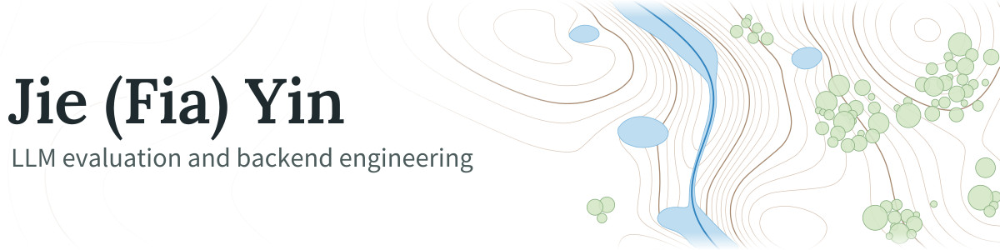

<!--
  Profile README for github.com/Lunarc-Seattle.
  The banners live in assets/. Project pictures load straight from each project's own repo.
-->

<picture>
  <source media="(prefers-color-scheme: dark)" srcset="assets/banner-dark.svg">
  
</picture>

I'm an Information Systems master's student at Northeastern's Silicon Valley campus, working across **UI development, LLM post-training and backend engineering**. I've been a TA for Advanced Techniques with Large Language Models, for 2 semesters, and in my research I'm adapting multimodal models to geospatial reasoning with **SFT, GRPO and Reinforcement Learning Reward Design**.

Selected as 1/8 students university-wide for a fully funded exchange year in University of Florida, many of my landscape architecture projects happened here, from my capstone design in DeBary to a flood and coastline plan for St. Augustine. Doing the visualization and sea level analysis by hand took forever, so I **taught myself to code** to automate it. That's how I ended up with both a designer's eye and an engineer's habits. The St. Augustine pipeline below is that study rebuilt properly in code.

Now I build Python pipelines and tools that run unattended, check their own results and **give the same output on every rerun**: automated runs with retries and resume, regression tests in CI, versioned data and results. I'm looking for SDE roles in simulation and data tooling, and LLM engineering roles.

### Current LLM research

**LLM failure mode discovery: flood reasoning from site maps** 
Research with Prof. Lai at Northeastern

Multimodal LLMs such as DeepSeek and Gemini miss almost every floodplain cell without mapped water (3/49 and 0/49), while a blind human gets 24 of 26. I built the 194-site dataset and the RL reward for this task, caught a reward hack along the way, and am now using post-training with SFT and GRPO on a reinforcement learning vision-language model.

The repo is private so future models can't find the answers. [Contact me](https://www.linkedin.com/in/jiefiayincodingirl/) for details.

### Projects

<table>
  <tr>
    <td width="50%" valign="top">
      
      <h4><a href="https://github.com/Lunarc-Seattle/breath-runner">Breath Runner</a></h4>
      
A breathing rehab game for people recovering from lung surgery at home: breathe into the microphone to jump and glide. I designed the trainer, the app and the illustrations, then built it in React and TypeScript, with unit and end-to-end tests gating every deploy. Two versions are playable: <a href="https://lunarc-seattle.github.io/breath-runner/v1/">v1</a>, the first release, and <a href="https://lunarc-seattle.github.io/breath-runner/v2/">v2</a>, with the redesigned app pages.

      React, TypeScript, Playwright, illustration
    </td>
    <td width="50%" valign="top">
      
      <h4><a href="https://github.com/Lunarc-Seattle/st-augustine-slr">St. Augustine sea level rise</a></h4>
      
How much of St. Augustine, Florida floods at 1 to 9 ft of sea level rise, rebuilt as a one-command Python pipeline on NOAA, Census and OpenStreetMap data. Reruns give byte-identical results, each run records SHA-256 hashes of every input and output and checks its own invariants, and CI tests it on Linux, macOS and Windows.

      Python, GeoPandas, pytest, GitHub Actions
    </td>
  </tr>
</table>

### Backend projects

[CloudBite Engine](https://github.com/Lunarc-Seattle/CloudBite-Engine) is a food delivery backend on Spring Boot, MyBatis, MySQL and Redis, with JWT auth and WebSocket order alerts. It includes 18 bilingual engineering notes where I question and verify the course material instead of copying it.

[Patient management microservices](https://github.com/Lunarc-Seattle/SpringBoot) is a patient management system split into five Spring Boot services that talk over gRPC and Kafka behind an API gateway, running locally on Docker and LocalStack.

### Tools

<picture>
  <source media="(prefers-color-scheme: dark)" srcset="https://skillicons.dev/icons?i=java,spring,py,ts,react,mysql,postgres,redis,kafka,docker,githubactions&theme=dark">
  
</picture>

Reach me on [LinkedIn](https://www.linkedin.com/in/jiefiayincodingirl/).
